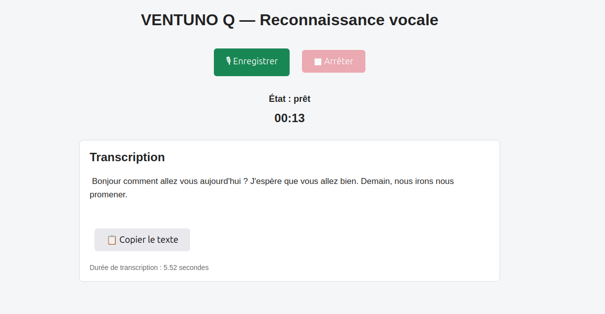

# VENTUNO Q — Local Speech Recognition with Arduino App Lab

A local speech-to-text application for the **Arduino VENTUNO Q**, built with **Arduino App Lab**. Record speech from the Media Carrier microphone using a browser-based interface, stop recording whenever you choose, and automatically transcribe the captured audio with Arduino's ASR brick.

The application was developed and tested with **French speech**. In testing, the transcription included automatically generated punctuation.

## Screenshot



*Example: a 13-second French recording transcribed in 5.52 seconds on the VENTUNO Q. Timing is an observation from one test, not a performance guarantee.*

## Features

- **Start / Stop recording** from the WebUI; no fixed recording duration is required.
- Capture audio with Arduino's `Microphone` API using a continuous stream.
- Save each recording as a WAV file, replacing the previous file.
- Automatically start local speech recognition after recording stops.
- Display the recognized text, recording duration, and ASR processing time.
- Copy the transcription using the **Copy text** button (subject to browser clipboard permissions).
- Keep the interface responsive during recording and transcription.

## Hardware and software

- Arduino **VENTUNO Q** with its **Media Carrier microphone**.
- **Arduino App Lab**.
- Arduino `Microphone` API (`arduino.app_peripherals.microphone`).
- Arduino **ASR** brick (`arduino.app_bricks.asr`).
- Arduino **WebUI** brick (`arduino.app_bricks.web_ui`).
- Python on the VENTUNO Q MPU; HTML, CSS, and JavaScript in the WebUI.

The tested microphone settings were **16 kHz**, **mono**, **16-bit PCM**, using ALSA device `hw:0,1` and a buffer size of `1120` samples. Audio device names may differ on other systems.

## How it works

1. Open the application WebUI.
2. Click **Enregistrer** (Record) and speak into the microphone.
3. Click **Arrêter** (Stop) when finished.
4. The application closes the audio recording, writes a WAV file, and invokes the ASR brick.
5. The recognized text appears automatically in the WebUI.
6. Click **Copier le texte** (Copy text) to copy the result.

The interface also displays the recording duration and the measured transcription time.

## Implementation overview

```text
Browser / WebUI
   |  GET /api/record
   |  GET /api/stop_record
   |  GET /api/status
   v
Python recorder
   |  Microphone.stream() — 16 kHz mono PCM
   |  Stop signal from the WebUI
   v
WAV file (overwritten on each recording)
   |
   v
WAVAutomaticSpeechRecognition
   |
   v
Recognized text -> /api/status -> WebUI
```

The audio acquisition runs in a worker thread, so the WebUI can receive a stop request while recording is active. The WAV data is passed to `WAVAutomaticSpeechRecognition`, and the transcription is shown when processing completes.

### API endpoints

| HTTP endpoint | Purpose |
| --- | --- |
| `GET /api/record` | Start a new recording. |
| `GET /api/stop_record` | Request recording stop and subsequent transcription. |
| `GET /api/status` | Read application state, recording duration, transcription text, errors, and ASR time. |

### Relevant Arduino APIs

```python
from arduino.app_peripherals.microphone import Microphone
from arduino.app_bricks.asr import WAVAutomaticSpeechRecognition
from arduino.app_bricks.web_ui import WebUI
from arduino.app_utils import App
```

## Observed results

The following results were obtained during development on the VENTUNO Q:

| Recorded audio | ASR transcription time | Observation |
| --- | --- | --- |
| 18 seconds | 5.44 seconds | French transcription displayed in the WebUI. |
| 13 seconds | 5.52 seconds | French transcription with punctuation. |

The second example correctly included a question mark, sentence-ending periods, and a comma. As with any speech-recognition model, the transcription may contain spelling or punctuation errors.

## Notes and limitations

- Recording has **no preset duration**, but it is **not unlimited**: the current implementation holds audio chunks in memory until Stop is pressed. Avoid very long recordings until memory usage and ASR behavior have been evaluated.
- The WAV file is **replaced** at each recording; it is not a recording archive.
- The ASR model and its configuration are managed through the App Lab project. Actual model selection should be checked in the project's `app.yaml`.
- Clipboard access depends on browser security settings. `navigator.clipboard.writeText()` generally requires HTTPS or a secure context such as localhost.
- Transcription latency depends on recording length, model configuration, and system load.

## Development and acknowledgements

Developed and tested on the Arduino VENTUNO Q by **Philippe (`philippe86220`)**, with technical assistance from **OpenAI's ChatGPT** for the Python implementation, WebUI integration, debugging, and documentation.

The project uses Arduino App Lab and Arduino's microphone, ASR, and WebUI components. Thanks to the Arduino team for providing these tools.
